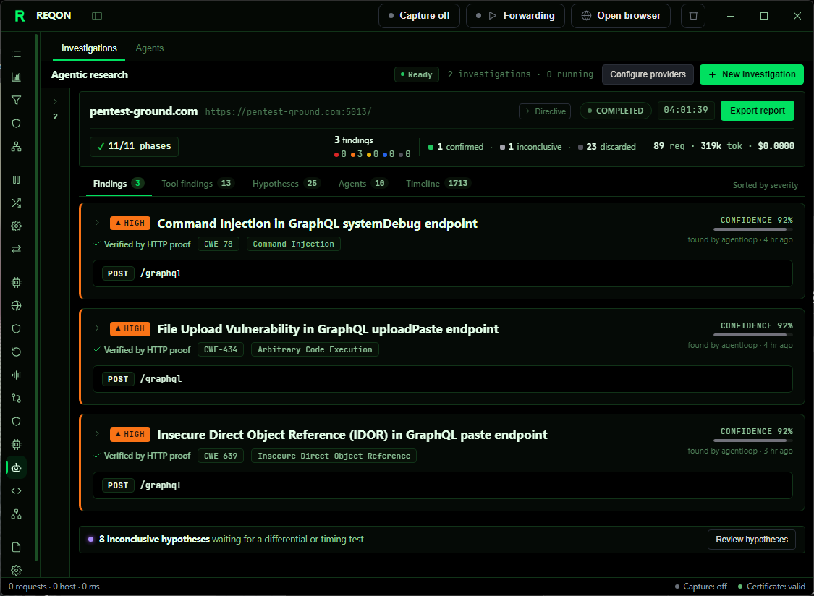

# REQON

**High-Performance HTTP Interception Proxy & Security Assessment Suite**

[](https://github.com/mzguardit/reqon/releases)
[](#installation-linux--ubuntu)

REQON is a modern, high-performance HTTP/HTTPS interception proxy and security assessment suite built for authorized penetration testing, AppSec engineering, and web application debugging.

Official homepage: [exploitfinder.com](https://exploitfinder.com)

<p align="center">
  
</p>

<p align="center">
  
</p>

---

## Key Features

### High-Performance HTTP/HTTPS Interception
Inspect, intercept, pause, and modify live HTTP/HTTPS requests and responses with minimal latency and a clean, modern interface.

<p align="center">
  
</p>

### Agentic Security Assessment & Workflows
Streamline web application and API vulnerability testing with automated security assessment workflows built for speed and precision.

<p align="center">
  
</p>

- **Fast Native Experience:** Designed for speed and clarity without heavy legacy runtimes.
- **Flexible Linux Packaging:** Available as `.deb`, `.AppImage`, and portable `.tar.gz`.

---

## Installation (Linux / Ubuntu)

### Option 1: Debian / Ubuntu (`.deb` package) — Recommended

```bash
wget https://github.com/mzguardit/reqon/releases/download/v1.0.0/reqon_1.0.0_amd64.deb
sudo apt update
sudo apt install -y ./reqon_1.0.0_amd64.deb
